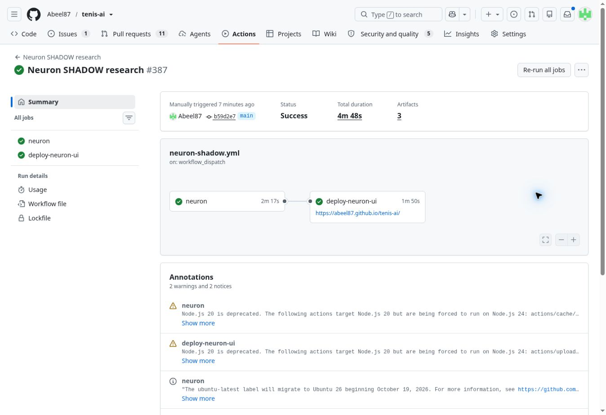

# Source-contract repair — 2026-11-02

The owner requested repairs and deployment after the remaining source problems
were described. Fresh base: `83ab0ca7d56aa9edb474f833b84286a6dfc046d4`.
This change repairs the canonical TML loader; it does not change model math,
learning thresholds, forecasts, settlement or Neuron/Self Evolution SHADOW status.

## Reproduced defect and repair

The declared Challenger ongoing URL returned HTTP 200, a valid 50-column CSV
header, 493 bytes and zero matches. The provider catalogue confirmed that same
file. Its displayed link label is not an alternative URL. The previous loader
misclassified every empty DataFrame as a transport failure and could retain an
obsolete ongoing snapshot.

Only the three explicitly declared rolling feeds now accept an empty frame with
the required identity schema. Annual empty archives, missing/invalid headers and
real download failures remain invalid. Cache reads and freshness preview use the
same canonical validator. Valid emptiness replaces old rows, records the real
fetch time, and is exposed in `empty_source_keys`/`fresh_empty`; no rows are
invented. A failed refresh retains the old timestamp and emits its warning.

The regressions failed before the fix: 5 failures. All 22 focused cache, source
and freshness tests passed afterwards. A real seven-source fetch at 08:52 UTC
produced **7 successful / 0 failed** reads. The 62 short-history players gained
no qualifying pre-match rows from that refresh; this is an ingestion correctness
fix, not a claimed model-coverage or accuracy gain.

## Remaining data boundaries

Strict complete-token coverage against the same 394-fixture input, using clean
declared current/2025 history strictly before 2026-11-02:

| Tour | Fixtures | At least one player missing history |
| --- | ---: | ---: |
| ITF | 217 | 216 |
| Challenger | 124 | 33 |
| WTA | 29 | 6 |
| ATP | 24 | 1 |

These counts include already-started fixtures and are not Neuron scoring counts.
The existing PBP schema audit (`41408800156`, artifact `13124423209`) projected
30 unique payloads: zero were ready for model-history ingestion and no duplicate
calibration sample proved schema compatibility. Existing bounded provider
backfill remains active; raw point tapes are not substituted for validated
serve/return histories or cross-provider identities.

Reproducing the previous frozen 2024 candidate yielded 12,474 rows, but three source hashes and
the candidate hash differ from the Sept 17 lock. Original artifact `10509752222`
records 6,063 raw Challenger rows versus 5,936 now. It contains hashes/reports,
not the old raw rows, so a complete old/new field comparison is unavailable.
All nine current visible resolution changes are `none -> exact` for archive-only
players. No global ID, exact-shadow or score conflict was found in the candidate.
Those findings do not authorize treating old history as current form.

## Separately reviewed 2024 candidate

The owner requested repairs/deployment after the remaining archive problem was
described. The new candidate is a fresh audit revision from the four official
source files whose raw hashes, dates and logical hashes are recorded; it is not
represented as byte-equivalent to the historical candidate. The full previous
manifest is retained in the JSON evidence and the revision's basis records the
previous expected fingerprints.

All existing ID, score, exact-shadow and visible-resolution exclusions remain.
In addition, the review freezes exclusions for **all 236 archive-only player
keys** absent from the current clean baseline, including players not on today's
fixture list. This removes 854 additional candidate rows, leaving **11,620**.
Every exclusion has actual matching source-row evidence. Ten numeric consistency
checks of the surviving serve/return counters found zero violations; unknown
values remain unknown. The baseline identity-set digest is recorded.

Both canonical archive audits now recheck that every remaining candidate player
exists in the current baseline. Removing those identities later fails closed;
the exclusion list does not expand automatically. This closes the future-fixture
gap in the former visible-only identity check. Original conflict checks, the
frozen TASK 016 shape, source URLs and strict source/candidate fingerprint checks
remain in force. The equivalence workflow reads the exact reviewed row count
from the locked manifest instead of retaining the obsolete hardcoded 12,474.

The new checks were reproduced failing before implementation. Final regression:
**1893 passed** in 87.04s (two existing NumPy empty-fixture warnings); archive
focused tests: 16 passed. UI smoke after the required delivery build retained
394 matches and all 216 Symphony cards; both readiness fixtures passed.

The same-input runtime-equivalence audit verifies the new 11,620-row lock and zero
identity changes. Its separate integration gate correctly remains **false**:
adding the candidate would alter shared surface priors and change 35 matches
without direct archive history. This is reported, not suppressed, and no archive
is imported. Model probability, training and current form remain unchanged.
The full candidate safety audit passed: exact source/candidate hashes match, every exclusion has evidence, and global ID, exact-shadow, score, visible-resolution and archive-only identity conflicts are zero. All three source audits subsequently passed remote CI. No provider replacement
or automatic re-locking is authorized or performed.

## Green merge and deployed verification

[PR #571](https://github.com/Abeel87/tenis-ai/pull/571) merged as
`7b034576ccb9121fbb13652e6948cfd515f94b7f`. Exact reviewed head
`ec893d34953af9ef49a76196154476e9415d16db` passed all 14 check runs across
11 workflows. Candidate-lock (`41418930931`), freshness (`41418930998`) and
runtime-equivalence (`41418931176`) audits are green; the last one still reports
the negative integration decision rather than suppressing it.

Fresh main `65b76ee05a1c26b55ef742ea6609a028780ac2fd` added three generated
Neuron files with no source overlap. The prospective merge passed **1893 tests
in 72.83s** and the actual rebuilt-delivery UI smoke. Actual merge tree
`89ea8583aeeb9977e8c90f81ba2dd79b20c58ae8` exactly equals the verified tree.
Post-merge UI/project-health, CodeQL and delivery/security checks also succeeded.

[Main Neuron run 41420205489](https://github.com/Abeel87/tenis-ai/actions/runs/41420205489)
executed the merged source from `b59d2e76260ebe1a104f62c5f644d69697323e89`:
training **ACCEPTED**, every candidate quality check passed, and training/scoring
both report **3 fresh + 8 cached sources, 0 missing, 0 source warnings** with
`empty_source_keys=["ch_ongoing"]`. Training was generated at 09:25:08Z and
scoring at 09:25:25Z. Model ID remains
`neuron-27a48846f9da06eac56a20bd9239b2821648f1e645ad17d62bb7193361f962d7`;
this does not establish improved predictive performance. Routine GitHub action
runtime deprecation notices are separate from data-source warnings.

Both Neuron job `125193663665` and Pages job `125194762183` succeeded. Evidence
artifact: `13129378010`; published commit:
`c19d7ad2d917dabd0d8f874b46c9f8a838d9b580`. Private runtime delivery
`41420874849` also succeeded and published all three Neuron objects in generation
`edda659f-1bfb-4b0a-9c0e-f53ff164d6f6`.

## Prospective learning-baseline capture

The earlier regular core run `41410144798` and Pages job `125188554576`
succeeded and published `d4dc1c384e5cee8886b603a60acdcd8649762599`. A direct
ledger comparison confirms growth from 111,491 to 111,507 records: **16 new
records across 11 fixtures**, each with the actual frozen ensemble probability,
owner/version and a pre-match capture timestamp (08:56:01.802753Z). No prior
record was changed or removed. These are supported-market forecasts, not eleven
settled match-winner comparison pairs. No past forecast is reconstructed.

## Completed full core and measured backfill yield

The previously pending full core run
[41420067325](https://github.com/Abeel87/tenis-ai/actions/runs/41420067325)
completed successfully: build `125193821970`, Pages `125208384717`. Final full
regression after generated layers passed **1893 tests in 68.34s**, with the same
two existing NumPy fixture warnings. It published
`f2c9c3fe86925f325277c58b64f13d4197a901ee`. The actual core source read reports
3 fresh + 8 cached sources, zero missing and zero download warnings.

Private core delivery `41424859714` also succeeded: generation
`f7f92e6b-45a8-4c62-af7c-ca3588fb5085`, 385 files with 367 objects uploaded.
The existing private-publisher receipt verifies publication; it is not a claim
of an authenticated end-user UI session.

The booster made **530 API calls** in three existing bounded passes:

| Pass | Calls | New PBP tapes | Parsed | Not parsed |
| --- | ---: | ---: | ---: | ---: |
| Current-player priority (24 players) | 50 | 2 | 2 | 0 |
| Global pass 1 | 240 | 236 | 219 | 17 |
| Global pass 2 | 240 | 235 | 212 | 23 |
| Total | 530 | 473 | 433 | 40 |

The tape cache increased from 17,183 to 17,656. Failed extraction remains
visible; no row is invented or counted as valid to conceal a failure. PBP tapes
feed their declared point-history consumers. They do not automatically satisfy
the serve/return model-history schema, solve player identity, or demonstrate
increased ITF coverage. The current-player pass's two usable tapes are the
directly measured target yield, not 473 newly covered current players.

The published canonical coverage audit at 09:47:16Z contains **324 visible
matches**, 138 with history for both players, **113** satisfying the five-match
minimum, and **186** missing history for at least one player. The clean declared
model-history input has 25,430 rows. This is a different fixture population from
the earlier 394-match audit, so the two counts do not establish before/after
coverage improvement. Latest verified main for this receipt:
`5eec71f86db96218a3084723afaa4297ada4c3e1`.

Subsequent scheduled Neuron run `41424859731` also passed scoring/evaluation and
Pages. Its evaluation at 09:59:49Z reports **zero settled current-model matches
(137 pending)** and **zero settled frozen-production comparison pairs**. The 167
settled forecasts across older model versions are separate evidence. No new-model
accuracy or production-readiness claim follows from them. Neuron/Self Evolution
remain SHADOW; the 2024 archive integration gate remains false.

The deployment verification is complete. Further evaluation needs naturally
settled current-model comparisons and measured same-input history coverage gains,
not another replay of the completed rollout. A later scheduled core run is a new
normal cycle and does not change the success of run `41420067325`.

Machine-readable receipts, hashes, before/after summaries, deployed evidence
and explicit limitations are in `history_source_contracts_20261102.json`.
