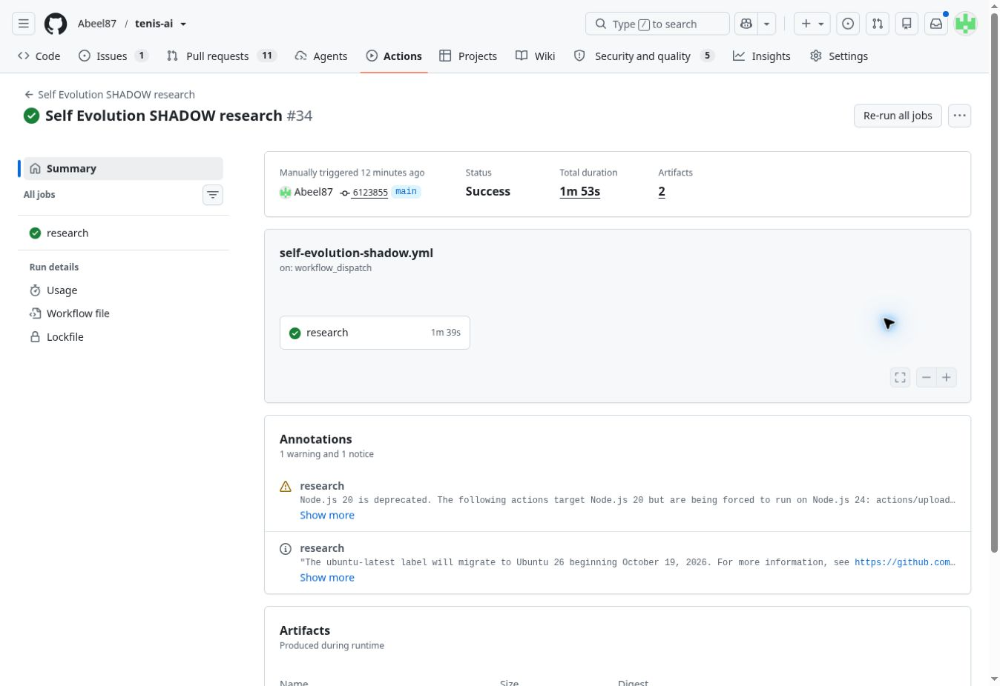

# Neuron / Self Evolution readiness repair — 2026-11-02

Scope: authorized SHADOW data-coverage and evaluation repair. No model math,
training, weights, thresholds, settlement rules, betting or PROD promotion.
Base: `9a75e590114ce6458b4c83d10be33275ea7c802d`.
Machine-readable evidence: `shadow_learning_readiness_20261102.json`.

## Reproduction and observed impact

The current Neuron snapshot was generated at 03:00:29 UTC on 2026-11-02.
Its 425 fixtures had 132 scores, 289 missing-history refusals and 4 already-started
refusals. Replaying the old and repaired `current_features` functions on the same
10 cached source frames, canonical hygiene, exclusive 2026-11-02 cutoff and
snapshot clock gives 136 scores, 285 missing-history refusals and the same 4
already-started refusals. All three feature arrays for all 132 existing scored
fixtures are exactly equal (including NaNs). This is a local same-input replay,
not a post-deployment coverage claim.

Five player occurrences have one unique history key with the exact same complete
normalized name tokens in a different order. Four fixtures recover both players:
213790, 213879, 213874, 213332. The fifth still lacks its opponent's history.
Initials, partial names, spelling guesses and ambiguous keys remain rejected.
The new opt-in mode belongs to the existing canonical resolver; default behavior
for all other consumers is unchanged. JSON records exact names/keys, source
hashes, fixture SHA and retained match counts. Most missing players are genuinely
absent from the currently declared sources; this patch cannot supply that history.

The Neuron workflow did not restore the core TML history cache. It now restores
that same cache before training/scoring; the core workflow retains save ownership.
Existing source timestamps, due-refresh logic, empty-source diagnostics and model
quality gates stay intact. Actual cache-hit behavior still requires CI/live proof.

## Evaluation correction

The 111,019-row source ledger has zero frozen AutoLearn ensemble scores. Existing
three-model inputs cannot prove the actual dynamic ensemble output from the past.
AutoLearn now observes its existing computed ensemble result before display
rounding and selection, freezes it at the ledger's normal 12-decimal precision,
and timestamps capture after computation. Old immutable rows are never enriched.

The shared reader validates score/producer ownership, finite probability and
strict pre-match chronology. Neuron additionally requires exact fixture ID,
start time and winner selection, reports per-model common cohorts and exposes
pending reasons. Self Evolution reports candidate vs actual AutoLearn on the
same holdout/prospective rows, balanced per independent fixture. Its candidate
optimization, registration window and internal SHADOW champion policy are unchanged.
The comparison concerns AutoLearn PRE_SELECTION, not final betting decisions.

The existing Neuron ledger has 106 settled binary fixtures across versions and
32 for the active version. Its current-version Brier is 0.211445 versus Elo
0.204309; there is no demonstrated superiority from that sample. All 32 remain
N/D against AutoLearn because the actual frozen baseline is missing. Pending
schedule conflicts/missing/unterminated results remain pending, not invented
losses. No profitability or production-readiness claim follows from these repairs.

## Verification and delivery

New regression cases reproduced failures before implementation. Tests cover
exact identity/ambiguity, feature parity, cache ownership, actual dynamic-output
capture, unchanged decorated predictions, append-only legacy rows, strict
pre-match provenance, exact common fixtures, per-version cohorts, missing
baselines, prospective registration windows and bounded private UI projection.
The readiness consumer matrix is updated only for moved frontend line numbers.

Current test/PR/merge/deployment results and next steps are recorded in the
latest `TENIS_AI_EXECUTION_CHECKLIST.md` LIVE CHECKPOINT. Existing TML freshness
and locked-2024-source audits have external-source blockers in PR #568; these
contracts must not be weakened or relocked merely to make this change mergeable.

PR #569 initial head `49317cba3b759c16295e38fbf7127fb339ba3f2c` passed the
actual Neuron training workflow (run 41407198027, job 125151814633): core cache
restored, 2 fresh + 9 cached sources, zero missing sources, 11 cache files,
training ACCEPTED and quality gate passed. The ongoing Challenger source remained
explicitly cached because fresh retrieval failed. This proves the cache wiring
in PR CI, not a main deployment. Self Evolution PR isolation/tests passed too.

The same initial head reproduced two existing external blockers: freshness run
41407197693 has 6/7 fresh source retrievals; 2024 equivalence run 41407197746 cannot
verify the locked candidate fingerprint. Neither contract is relaxed. Three
older identity/history audit workflows also failed full regression because they
did not restore the exact chunked ledger. The workflows now invoke the existing
canonical restore command before pytest. Three failing-before regression cases
cover that ordering; no tests, assertions or audit gates are skipped.

A final review also reproduced a floating-point rounding case where equal
reported Brier values could be labelled improved. The new descriptive status
now uses its existing nine-decimal reporting precision; model values, optimization
and promotion thresholds are untouched. Regression test records that example.

Final local source validation: 1879 tests passed in 68.64 seconds with the two
existing empty-fixture NumPy warnings. All UI smoke scenarios and required
project-health stages passed; runtime health reports zero failures and the two
existing payload warnings against base `9a75e590...`. Merge/deploy are unperformed
while the unchanged external source gates remain red. See #569 for final-head CI.

Final source head `13379befc6074476603ef964a1af778c9bb06dcb`, preserving fresh
main `42eb1415066a97789c6a3719101965cb9c41dd5f`, passed all three repaired audit
workflows (41407962109, 41407962185, 41407962295). The last includes 1879 passing
tests in 86.51 seconds. Neuron and Self Evolution passed again (41407962300,
41407962157). Freshness 41407962119, archive equivalence 41407962077 and archive
candidate lock 41407962323 remain red. The archive preview has both mismatched
fingerprints and 9 visible identity-resolution changes; silently relocking it
would not establish its safety. Merge/deployment remain unperformed. This
closeout updates evidence only and does not change the verified implementation.

UI & Project Health 41407962296 also completed successfully. The verified source
head has 20 successful workflows and the 3 source-contract failures above.

## Deployment after explicit owner follow-up

After disclosure of the three red source audits, the owner instructed “Oka to
wdrazaj i jazd”. PR #569 was merged as `39bc81174277c8b17c9702b46d438056d6bfa5bb`
under that specific follow-up authorization. This does not relock the 2024
archive, alter its failing audit, change general merge policy or promote SHADOW
models to production. Earlier unmerged status in this audit is historical.

The exact reviewed head `e33da60fc6e99474f50f7b099a1920c20a73fb21` was replayed
against fresh main `2f80d5af96f0b927e53488aba159d6c4cb2bec36`: 1879 tests passed
in 91.93 seconds, with the same two NumPy warnings; UI smoke and JS syntax passed.
The merged tree exactly equals locally verified tree
`2cf663ee9ac0224a3e593548cf9de6b1fbfc2edb`.

Neuron main run [41410144535](https://github.com/Abeel87/tenis-ai/actions/runs/41410144535)
trained an accepted SHADOW model, passed its quality gate and published scoring
and evaluation. Cache availability is 2 fresh + 9 cached, zero missing; fresh
Challenger retrieval remains an explicit warning. The new model has 127 pending
fixtures and zero settled outcomes, so it establishes no live superiority.
The real Pages job 125161870310 succeeded at 08:06:28 UTC. Public app.js and
neuron-data-bridge.js hashes exactly match reviewed source. Browser inspection
confirmed the public login screen; an authenticated private-screen review is not
claimed. Main health/security/CodeQL passed. Private Neuron run 41410648364
activated generation `9812715a-4ef6-4ebd-ba67-6aae4e32567b`.

[Self Evolution run 41410638588](https://github.com/Abeel87/tenis-ai/actions/runs/41410638588)
was manually dispatched on main `6123855006370340dcb8d1cb886a7e2a25c856f1`.
It restored previous memory from 41302075293 and completed run 25 with three
tracks. All no-production-authority assertions passed. The actual-production
comparison has zero paired rows and remains explicitly unavailable; historical
rows were not backfilled. Private research run 41410860422 used this exact report
and activated generation `350edc4d-895a-4df2-ab11-e35e5c5045a7`.

Core/Pages run 41410144798 is still pending behind existing update 41408549926
at this checkpoint. First runtime capture of new AutoLearn baselines is not yet
claimed. The code, UI and SHADOW report publications are deployed and verified;
follow the normal core completion to verify its new immutable ledger rows and
private core publication. No schedules/concurrency were changed and no running
update was cancelled. Known source freshness and archive-lock issues remain open.
